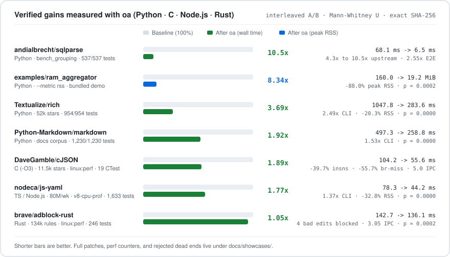
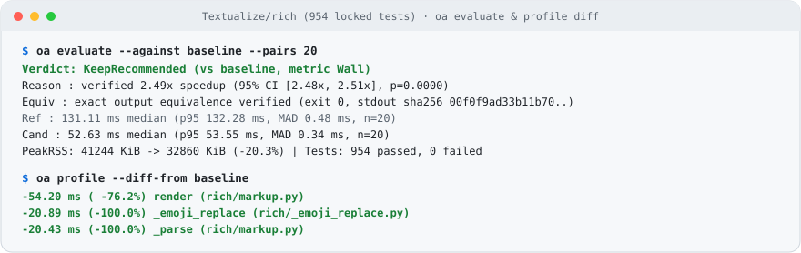
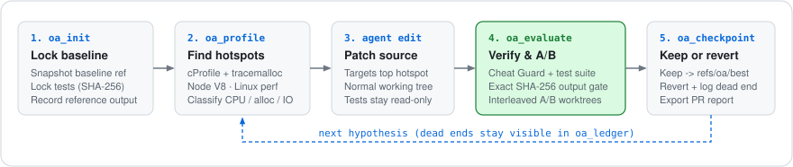

<div align="center">

# oa

**Optimize Anything: profiling, equivalence gating, and interleaved A/B benchmarking for coding agents.**

[Quick start](#quick-start) · [Showcases](#showcases) · [How oa works](#how-oa-works) · [MCP & CLI](#mcp-and-cli) · [FAQ](#faq)

<br/>

<picture>
  <source media="(prefers-color-scheme: dark)" srcset="docs/assets/oa-hero-dark.svg">
  <source media="(prefers-color-scheme: light)" srcset="docs/assets/oa-hero-light.svg">
  
</picture>

</div>

<br/>

Coding agents are good at rewriting code and bad at proving it got faster. Left to run ad-hoc `time` commands, they guess at bottlenecks, keep changes inside run-to-run noise, drop edge-case handling, or quietly loosen assertions to make a benchmark pass.

`oa` is a single Rust binary (1.4 MB, `#![forbid(unsafe_code)]`, 2 direct dependencies) that runs as both a local CLI and a stdio MCP server. It locks your tests and benchmark scripts with SHA-256 hashes, profiles Python, Node.js, Go, Linux `perf`, and macOS `sample`, verifies exact output equivalence, and runs balanced interleaved A/B pairs against a detached git shadow worktree of your baseline before recommending a keep or revert.

## Quick start

### Install

```bash
curl -fsSL https://raw.githubusercontent.com/alexander-src/oa/main/install.sh | sh
```

Or build from source with Cargo:

```bash
cargo install --git https://github.com/alexander-src/oa.git
```

Prebuilt binaries are attached to [GitHub Releases](https://github.com/alexander-src/oa/releases). Run `oa doctor` after installing to check available profilers, RSS support, and detected coding agents.

### Connect your agent (MCP)

Register `oa` as an MCP server and install its optimization workflow skill in one command (auto-detects Claude Code, Antigravity, Cursor, Gemini CLI, and Codex):

```bash
oa setup
```

> **Try asking your agent:**
> *"Use oa to initialize an optimization session in this repo (`bench_cmd`: `python3 bench.py`, `test_cmd`: `pytest -q`). Profile the hot path, iterate on the top bottlenecks, revert anything that fails Cheat Guard or Mann-Whitney U, and generate a final `oa_report`."*

### Use from the terminal (CLI)

```bash
# Lock tests/bench, snapshot refs/oa/baseline, capture reference SHA-256 and initial profile
oa init --bench "python3 bench.py" --test "pytest -q"

# Inspect hotspots (or diff against baseline after edits)
oa profile --top 12

# Run Cheat Guard -> tests -> SHA-256 equivalence -> balanced interleaved A/B
oa evaluate --pairs 12

# Keep verified win (updates refs/oa/best) or revert and log the dead end
oa checkpoint --keep --hypothesis "cache per-render Table strings"
oa checkpoint --revert --hypothesis "switch lexer to finditer" --dead-end "0.96x regression"

# Check live session health, diff stat, and export a PR-ready Markdown report
oa status
oa report
```

<p align="center">
  <picture>
    <source media="(prefers-color-scheme: dark)" srcset="docs/assets/oa-terminal-dark.svg">
    <source media="(prefers-color-scheme: light)" srcset="docs/assets/oa-terminal-light.svg">
    
  </picture>
</p>

Need a quick interleaved A/B comparison without initializing a session? Use `oa compare` on any two commands:

```bash
oa compare "python3 old.py" "python3 new.py" --pairs 15 --check-output
```

To reduce memory footprint instead of latency, pass `--metric rss` to `oa init`, `oa evaluate`, or `oa compare`. Want to try it immediately? Clone this repo and run `oa` on [examples/slow_log_parser](examples/slow_log_parser) (`--metric wall`) or [examples/ram_aggregator](examples/ram_aggregator) (`--metric rss`).

## Showcases

Every result below was measured on real code with locked test suites, byte-identical output SHA-256 checks, and balanced interleaved A/B pairs. Click any showcase for the full experiment ledger, profile diff, rejected dead ends, and apply-ready patch.

<table>
  <thead>
    <tr>
      <th>Target</th>
      <th>Metric</th>
      <th>Verified result</th>
      <th>Verification</th>
      <th>Case study</th>
    </tr>
  </thead>
  <tbody>
    <tr>
      <td><strong>Textualize/rich</strong><br/><sub>Python · 52k+ stars</sub></td>
      <td>Wall time<br/><sub>+ Peak RSS</sub></td>
      <td><strong>3.69x faster</strong> Table render (<code>1047.8&nbsp;→&nbsp;283.6 ms</code>)<br/><sub><strong>2.49x</strong> full CLI incl. cold Python start, <code>-20.3%</code> RAM</sub></td>
      <td>954/954 pytest pass<br/><sub><code>p = 0.0000</code> · exact ANSI SHA-256</sub></td>
      <td><a href="docs/showcases/rich.md">Report</a> · <a href="docs/showcases/rich.patch">Patch</a></td>
    </tr>
    <tr>
      <td><strong>andialbrecht/sqlparse</strong><br/><sub>Python · ~4k stars · 30M+ PyPI/mo</sub></td>
      <td>Wall time<br/><sub>+ Peak RSS</sub></td>
      <td><strong>2.55x faster</strong> (<code>253.9&nbsp;→&nbsp;99.8 ms</code>, <code>-7.9%</code> RAM)<br/><sub><strong>4.3x to 10.5x</strong> across upstream <code>benchmarks/*.py</code></sub></td>
      <td>537/537 pytest pass<br/><sub><code>p = 0.0000</code> · 1 regression caught</sub></td>
      <td><a href="docs/showcases/sqlparse.md">Report</a> · <a href="docs/showcases/sqlparse.patch">Patch</a></td>
    </tr>
    <tr>
      <td><strong>Python-Markdown/markdown</strong><br/><sub>Python · ~4.1k stars · powers MkDocs</sub></td>
      <td>Wall time</td>
      <td><strong>1.92x faster</strong> convert (<code>497.3&nbsp;→&nbsp;258.8 ms</code>)<br/><sub><strong>1.53x</strong> full CLI incl. cold Python start</sub></td>
      <td>1,230/1,230 tests pass<br/><sub><code>p = 0.0000</code> · O(N^2) TOC bug fixed</sub></td>
      <td><a href="docs/showcases/python-markdown.md">Report</a> · <a href="docs/showcases/python-markdown.patch">Patch</a></td>
    </tr>
    <tr>
      <td><strong>brave/adblock-rust</strong><br/><sub>Rust · 134,208 EasyList rules</sub></td>
      <td>Wall time<br/><sub>Linux <code>perf</code></sub></td>
      <td><strong>1.05x faster</strong> (<code>142.7&nbsp;→&nbsp;136.1 ms</code>)<br/><sub>already 3.05 IPC native Rust</sub></td>
      <td>246/246 cargo tests<br/><sub>2 regressions + 2 noise edits blocked</sub></td>
      <td><a href="docs/showcases/adblock-rust.md">Report</a> · <a href="docs/showcases/adblock-rust.patch">Patch</a></td>
    </tr>
    <tr>
      <td><strong>examples/ram_aggregator</strong><br/><sub>Bundled · reproducible in 15s</sub></td>
      <td>Peak RSS<br/><sub><code>--metric rss</code></sub></td>
      <td><strong>8.34x less RAM</strong> (<code>160.0&nbsp;→&nbsp;19.2 MiB</code>, <code>-88.0%</code>)<br/><sub>plus 1.29x faster wall time</sub></td>
      <td>2/2 locked tests<br/><sub><code>p = 0.0002</code> · exact SHA-256</sub></td>
      <td><a href="docs/showcases/ram-aggregator.md">Report</a> · <a href="examples/ram_aggregator/">Code</a></td>
    </tr>
    <tr>
      <td><strong>examples/slow_log_parser</strong><br/><sub>Bundled · reproducible in 15s</sub></td>
      <td>Wall time<br/><sub><code>--metric wall</code></sub></td>
      <td><strong>9.13x faster</strong> (<code>512.7&nbsp;→&nbsp;55.7 ms</code>)</td>
      <td>Locked test suite<br/><sub><code>p = 0.0002</code> · Cheat Guard demo</sub></td>
      <td><a href="examples/slow_log_parser/">Code</a></td>
    </tr>
  </tbody>
</table>

## How oa works

<p align="center">
  <picture>
    <source media="(prefers-color-scheme: dark)" srcset="docs/assets/oa-loop-dark.svg">
    <source media="(prefers-color-scheme: light)" srcset="docs/assets/oa-loop-light.svg">
    
  </picture>
</p>

`oa init` snapshots your repository into a hidden git ref (`refs/oa/baseline`) without touching your branches or commit history, checks out a detached shadow worktree under `.oa/worktrees/`, hashes every test and benchmark file, and records the baseline output SHA-256.

On every `oa evaluate`, `oa` enforces four gates in order. First, Cheat Guard re-hashes all locked files (normalizing CRLF on Windows) and aborts with `CheatBlocked` if an agent modified a test or benchmark. Second, your test suite must exit 0. Third, candidate stdout and any declared `--output-file` paths must match baseline via SHA-256 (`exact`, `normalized`, or a custom `oracle` command). Fourth, `oa` runs alternating `A/B` and `B/A` pairs between the shadow reference worktree and your working tree, then computes a two-sided Mann-Whitney U p-value (default `alpha = 0.01`) and a 2,000-resample bootstrap 95% confidence interval. Only candidates whose 95% CI lower bound clears the minimum speedup receive `KeepRecommended`.

## MCP and CLI

`oa mcp` speaks standard JSON-RPC 2.0 over stdio (supporting both newline-delimited JSON and `Content-Length` framing). Every MCP tool maps directly to a CLI subcommand:

| MCP tool | CLI command | Purpose |
| --- | --- | --- |
| `oa_init` | `oa init` | Snapshot baseline ref, lock tests/bench, capture SHA-256 and initial profile |
| `oa_profile` | `oa profile` | Run profiler, return hotspots with source snippets, classify bottleneck, diff vs prior |
| `oa_evaluate` | `oa evaluate` | Run Cheat Guard, test suite, equivalence gate, and interleaved A/B statistics |
| `oa_checkpoint` | `oa checkpoint` | Keep verified edit as `refs/oa/best` or revert working tree and log dead end |
| `oa_status` | `oa status` | Inspect live session metric, lock health, cumulative gain, and diff stat vs baseline |
| `oa_ledger` | `oa ledger` | Inspect experiment history, Pareto frontier IDs, and recorded dead ends |
| `oa_report` | `oa report` | Generate a PR-ready Markdown or JSON report |
| `oa_compare` | `oa compare` | Standalone interleaved A/B comparison of any two commands (no session needed) |
| - | `oa doctor` | Inspect local profilers, RSS sampling, CPU pinning, and connected agents |
| - | `oa setup` | Register `oa` MCP server and `SKILL.md` for detected coding agents |

### Supported profilers

| Target | Built-in backend | Signals captured |
| --- | --- | --- |
| Python | `cProfile` + `tracemalloc` | Top self/cumulative functions, call counts, source lines, peak traced allocations |
| Node.js | V8 `--cpu-prof` | Parsed `.cpuprofile` hit shares, call counts, and source snippets |
| Go | `go test -cpuprofile` + `pprof` | Flat/cumulative CPU ms and percentages, `.go` file:line, source snippets, GC/lock classification |
| Linux native (Rust/C/C++) | `perf stat` + `perf record` (auto `:u` rootless fallback) | IPC, branch miss rate, cycles, symbol-level hotspots |
| macOS native (Rust/C/C++) | `/usr/bin/sample` (1 ms stack sampler) | Top-of-stack symbol sample counts, alloc/lock classification, `rusage` fallback |
| Any other binary / OS | `rusage` + timing fallback | Wall latency, peak RSS, and bottleneck classification |

## Limitations

- `oa` benchmarks commands you can run from a shell; interactive GUI apps and live networked services need a deterministic harness command first.
- Peak RSS sampling (`--metric rss`) uses `/usr/bin/time` or Python `resource.getrusage` on Linux and macOS; Windows peak RSS support is tracked in [#3](https://github.com/alexander-src/oa/issues/3).
- macOS `/usr/bin/sample` needs workloads longer than ~200 ms to capture stack frames; shorter commands fall back cleanly to `macos:rusage`.
- Cheat Guard prevents modifying locked files and tests, though it cannot stop a benchmark command that does not actually exercise the target code.

## FAQ

<details>
<summary><strong>Does oa modify my git branch or commit history?</strong></summary>
<br/>
No. Snapshots are written to hidden refs (<code>refs/oa/baseline</code>, <code>refs/oa/best</code>, <code>refs/oa/exp/*</code>) and <code>.oa/</code> is added to <code>.git/info/exclude</code>. Your working branch, index, and <code>.gitignore</code> stay untouched.
</details>

<details>
<summary><strong>How does Cheat Guard stop agents from gaming benchmarks?</strong></summary>
<br/>
<code>oa init</code> auto-detects test directories, benchmark scripts, and build manifests (plus any paths passed via <code>--lock</code>) and stores their SHA-256 digests in <code>.oa/locks.json</code>. Every <code>oa evaluate</code> verifies those digests before running tests or timings; any edit returns <code>CheatBlocked</code>, which cannot be bypassed even with <code>--force</code>.
</details>

<details>
<summary><strong>Why interleaved A/B in shadow worktrees instead of before/after timing?</strong></summary>
<br/>
Thermal throttling, background daemons, and CPU frequency scaling easily shift sequential runs by 5% to 15%. Running alternating <code>AB</code>/<code>BA</code> pairs between a detached shadow worktree of baseline/best and your working tree cancels out drift, and the Mann-Whitney U test plus 95% bootstrap CI rejects noisy false positives.
</details>

<details>
<summary><strong>Can I optimize memory usage instead of runtime?</strong></summary>
<br/>
Yes. Pass <code>--metric rss</code> to <code>oa init</code>, <code>oa evaluate</code>, or <code>oa compare</code>. The interleaved A/B pairs, Mann-Whitney U test, confidence interval, and report then optimize Peak Resident Set Size (KiB) while still running the test suite and exact SHA-256 output gate. See <a href="docs/showcases/ram-aggregator.md">docs/showcases/ram-aggregator.md</a>.
</details>

<details>
<summary><strong>How do I contribute a new profiler adapter or feature?</strong></summary>
<br/>
Profiler backends live in <a href="src/profiler.rs"><code>src/profiler.rs</code></a>. See <a href="CONTRIBUTING.md"><code>CONTRIBUTING.md</code></a> and the open <code>good first issue</code> tickets.
</details>

## License

MIT. See [LICENSE](LICENSE).
