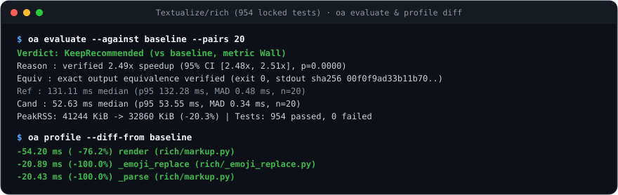
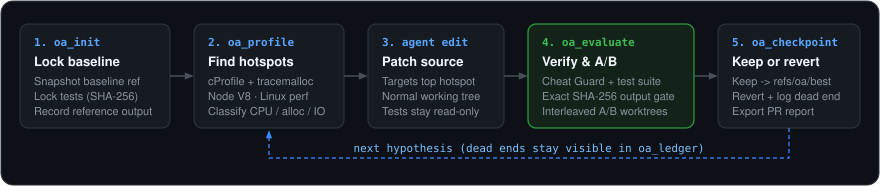

<div align="center">

# oa

**Optimize Anything: profiling, equivalence gating, and interleaved A/B benchmarking for coding agents.**

[Quick start](#quick-start) · [Showcases](#showcases) · [How oa works](#how-oa-works) · [MCP & CLI](#mcp--cli) · [FAQ](#faq)

<picture>
  <source media="(prefers-color-scheme: dark)" srcset="docs/assets/oa-hero-dark.svg">
  <source media="(prefers-color-scheme: light)" srcset="docs/assets/oa-hero-light.svg">
  
</picture>

</div>

Coding agents are good at rewriting code and bad at proving it got faster. Left to run ad-hoc `time` commands, they guess at bottlenecks, keep changes inside run-to-run noise, drop edge-case handling, or quietly loosen assertions to make a benchmark pass.

`oa` is a single Rust binary (`1.4 MB`, `#![forbid(unsafe_code)]`, 2 direct dependencies) that runs as both a local CLI and a stdio MCP server. It locks your tests and benchmark scripts with SHA-256 hashes, profiles Python, Node.js, Go, Linux `perf`, and macOS `sample`, verifies exact output equivalence, runs balanced interleaved A/B pairs against a detached git shadow worktree of your baseline, and generates PR-ready Markdown or SVG reports.

## Quick start

### Install

```bash
curl -fsSL https://raw.githubusercontent.com/alexander-src/oa/main/install.sh | sh
```

Or build from source with Cargo:

```bash
cargo install --git https://github.com/alexander-src/oa.git
```

Prebuilt binaries for Linux, Windows, and macOS are attached to [GitHub Releases](https://github.com/alexander-src/oa/releases).

### Try it in 1 second

Run the self-contained demo (creates a temp git repo, exercises Cheat Guard and Equivalence Gate, verifies a 6x+ speedup, and cleans up):

```bash
oa demo
```

Check local profiler backends, RSS support, and installed coding agents:

```bash
oa doctor
```

### Connect your agent (MCP)

Register `oa` as an MCP server and install its optimization playbook (`SKILL.md`) in one command (auto-detects Claude Code, Antigravity, Cursor, Gemini CLI, and Codex):

```bash
oa setup
```

> **Try asking your agent:** *"Use oa to initialize an optimization session in this repo (`bench_cmd`: `python3 bench.py`, `test_cmd`: `pytest -q`). Profile the hot path, iterate on the top bottlenecks, revert anything that fails Cheat Guard or Mann-Whitney U, run `oa_verify`, and generate a final `oa_report`."*

### Use from the terminal (CLI)

```bash
# Lock tests/bench, snapshot refs/oa/baseline, capture reference SHA-256 and initial profile
oa init --bench "python3 bench.py" --test "pytest -q"

# Inspect hotspots (or diff against baseline after edits)
oa profile --top 12

# Run Cheat Guard -> tests -> SHA-256 equivalence -> balanced interleaved A/B
oa evaluate --pairs 12

# Keep verified win (updates refs/oa/best) or revert and log the dead end
oa checkpoint --keep --hypothesis "pack parser events in Int32Array tape"
oa checkpoint --revert --hypothesis "switch lexer to finditer" --dead-end "0.96x regression"

# End-to-end verification gate (exits non-zero on tamper, test failure, or noise)
oa verify --pairs 20

# Export a PR-ready Markdown table or dark/light SVG chart
oa report --out REPORT.md
oa report --format svg --theme dark --out bench.svg
```

<p align="center">
  <picture>
    <source media="(prefers-color-scheme: dark)" srcset="docs/assets/oa-terminal-dark.svg">
    <source media="(prefers-color-scheme: light)" srcset="docs/assets/oa-terminal-light.svg">
    
  </picture>
</p>

Need a quick interleaved A/B comparison without initializing a session? Run `oa compare` on any two commands (add `--markdown` for a paste-ready PR table):

```bash
oa compare "python3 old.py" "python3 new.py" --pairs 15 --check-output --markdown
```

To reduce memory footprint instead of latency, pass `--metric rss` to `oa init`, `oa evaluate`, `oa verify`, or `oa compare`. Bundled walkthroughs are included under [`examples/slow_log_parser`](examples/slow_log_parser) (`--metric wall`) and [`examples/ram_aggregator`](examples/ram_aggregator) (`--metric rss`).

## Showcases

Every result below was measured on real code across Python, C (`-O3`), TypeScript/Node.js, and Rust with locked test suites, byte-identical output SHA-256 checks, and balanced interleaved A/B pairs. Click any showcase for the full experiment ledger, profile diff, hardware counters, rejected dead ends, and apply-ready patch.

<table>
  <thead>
    <tr>
      <th>Target</th>
      <th>Verified result</th>
      <th>Verification</th>
      <th>Patch</th>
    </tr>
  </thead>
  <tbody>
    <tr>
      <td><a href="docs/showcases/rich.md"><strong>Textualize/rich</strong></a><br><sub>Python · 52k+ stars · <code>cProfile</code></sub></td>
      <td><strong>3.69x</strong> Table render (<code>1047.8&nbsp;→&nbsp;283.6&nbsp;ms</code>)<br><strong>2.49x</strong> CLI · <strong>-20.3% peak RSS</strong> · <code>p=0.0000</code></td>
      <td>954/954 pytest pass<br>exact ANSI SHA-256</td>
      <td><a href="docs/showcases/rich.patch"><code>rich.patch</code></a></td>
    </tr>
    <tr>
      <td><a href="docs/showcases/sqlparse.md"><strong>andialbrecht/sqlparse</strong></a><br><sub>Python · 30M+ PyPI/mo · <code>cProfile</code></sub></td>
      <td><strong>4.3x to 10.5x</strong> upstream <code>benchmarks/*.py</code><br><strong>2.55x</strong> E2E (<code>253.9&nbsp;→&nbsp;99.8&nbsp;ms</code>) · <code>-7.9% RSS</code></td>
      <td>537/537 pytest pass<br>caught 1 regression (<code>0.96x</code>)</td>
      <td><a href="docs/showcases/sqlparse.patch"><code>sqlparse.patch</code></a></td>
    </tr>
    <tr>
      <td><a href="docs/showcases/cjson.md"><strong>DaveGamble/cJSON</strong></a><br><sub>C (<code>-O3</code>) · 11.5k+ stars · <code>linux:perf</code></sub></td>
      <td><strong>1.89x</strong> parse+print (<code>104.2&nbsp;→&nbsp;55.6&nbsp;ms</code>)<br><strong>-39.7% insns</strong> · <strong>-55.7% br-miss</strong> · <code>5.0 IPC</code></td>
      <td>19/19 CTest pass (<code>-Werror</code>)<br>180 locked files · 1 file changed</td>
      <td><a href="docs/showcases/cjson.patch"><code>cjson.patch</code></a></td>
    </tr>
    <tr>
      <td><a href="docs/showcases/js-yaml.md"><strong>nodeca/js-yaml</strong></a><br><sub>TS/Node · 80M+ npm/wk · <code>v8-cpu-prof</code></sub></td>
      <td><strong>1.77x</strong> <code>yaml.load</code> 6.9 MB (<code>78.3&nbsp;→&nbsp;44.2&nbsp;ms</code>)<br><strong>1.37x</strong> CLI · <strong>-32.8% peak RSS</strong> (<code>-58.5 MiB</code>)</td>
      <td>1,633 core + spec tests pass<br>caught 1 noise edit (<code>p=0.0404</code>)</td>
      <td><a href="docs/showcases/js-yaml.patch"><code>js-yaml.patch</code></a></td>
    </tr>
    <tr>
      <td><a href="docs/showcases/python-markdown.md"><strong>Python-Markdown</strong></a><br><sub>Python · MkDocs engine · <code>cProfile</code></sub></td>
      <td><strong>1.92x</strong> pure <code>convert</code> (<code>497.3&nbsp;→&nbsp;258.8&nbsp;ms</code>)<br><strong>1.53x</strong> CLI (<code>138.4&nbsp;→&nbsp;90.3&nbsp;ms</code>) · O(N^2) TOC fix</td>
      <td>1,230/1,230 unittest pass<br>caught 1 noise edit (<code>p=0.1572</code>)</td>
      <td><a href="docs/showcases/python-markdown.patch"><code>markdown.patch</code></a></td>
    </tr>
    <tr>
      <td><a href="docs/showcases/adblock-rust.md"><strong>brave/adblock-rust</strong></a><br><sub>Rust · 134k rules · <code>linux:perf</code></sub></td>
      <td><strong>1.05x</strong> (<code>142.7&nbsp;→&nbsp;136.1&nbsp;ms</code>, <code>p=0.0002</code>)<br><code>3.05 IPC</code> on already-tuned Rust</td>
      <td>246/246 cargo tests pass<br>blocked 2 regressions + 2 noise</td>
      <td><a href="docs/showcases/adblock-rust.patch"><code>adblock.patch</code></a></td>
    </tr>
    <tr>
      <td><a href="docs/showcases/ram-aggregator.md"><strong>examples/ram_aggregator</strong></a><br><sub>Python · bundled <code>--metric rss</code> demo</sub></td>
      <td><strong>8.34x less Peak RSS</strong> (<code>160.0&nbsp;→&nbsp;19.2&nbsp;MiB</code>)<br><code>-88.0%</code> RAM · <code>1.29x</code> wall speedup</td>
      <td>exact SHA-256 (<code>6f5b1b2e</code>)<br><code>p=0.0002</code></td>
      <td><a href="examples/ram_aggregator"><code>examples/</code></a></td>
    </tr>
  </tbody>
</table>

## How oa works

<p align="center">
  <picture>
    <source media="(prefers-color-scheme: dark)" srcset="docs/assets/oa-loop-dark.svg">
    <source media="(prefers-color-scheme: light)" srcset="docs/assets/oa-loop-light.svg">
    
  </picture>
</p>

1. **Profile first.** `oa profile` picks the right profiler for your command and returns a compact dossier: top hotspots with source snippets, allocation sites, hardware counters, bottleneck class (`CPU_ALGORITHMIC`, `SERIALIZATION_BOUND`, `ALLOC_PRESSURE`, `GC_OR_ALLOC_BOUND`, `LOCK_CONTENTION`, `IO_OR_SYSCALL`), and `--diff-from` hotspot deltas.
2. **Cheat Guard.** `oa init` hashes all tracked test and benchmark files into `.oa/locks.json`. Any edit to a locked file causes `oa evaluate` to abort with `CheatBlocked`, and `oa checkpoint --keep` rejects any post-evaluation working tree change via a full tree SHA-256 fingerprint.
3. **Behavioral Equivalence Gate.** Before timing, `oa` checks exit code and SHA-256 of `stdout`, `stderr`, and declared `--output-file` artifacts (with `--ignore-line` for timestamps or `--oracle` for fuzzy/numeric checks).
4. **Balanced interleaved A/B.** Every timed run alternates `A-B` and `B-A` pairs between your working tree and a detached git shadow worktree under `.oa/worktrees/` so CPU frequency scaling and background load cancel out. Cumulative session gains chain paired ratios rather than dividing un-interleaved medians taken minutes apart.
5. **Statistical verdict and verification gate.** `oa` accepts a change (`KeepRecommended`) only when two-sided Mann-Whitney U `p <= alpha` (default `0.01`) and the 2,000-resample bootstrap 95% CI lower bound exceeds `--min-speedup` (default `1.03x`). Run `oa verify` in a PR or CI pipeline to re-verify `HEAD` against `refs/oa/baseline` from scratch (non-zero exit on failure).

### Supported profiler backends

| Language / Runtime | Backend | Extracted signals |
| --- | --- | --- |
| Python | `python:cProfile+tracemalloc` | Function self/cum ms, call counts, source snippets, top allocation sites |
| Node.js / TS | `node:v8-cpu-prof` | V8 `.cpuprofile` sample tree, GC overhead, source file/line hotspots |
| Go (`go test`) | `go:pprof` | `go test -cpuprofile` + `go tool pprof -top` flat/cum ms, GC/lock class, snippets |
| Linux native (Rust, C, C++) | `linux:perf` | `perf stat` (IPC, branch-miss %, cache-miss %) + `perf record` symbol hotspots, automatic rootless `:u` fallback |
| macOS native (Rust, C, C++) | `macos:sample` | `/usr/bin/sample` top-of-stack symbol frames with automatic `macos:rusage` fallback |

## MCP & CLI

`oa mcp` speaks JSON-RPC 2.0 over stdio (both NDJSON and `Content-Length` framing) and exposes 9 tools:

| MCP Tool | CLI Equivalent | Purpose |
| --- | --- | --- |
| `oa_init` | `oa init` | Lock test/bench files, snapshot `refs/oa/baseline`, capture output SHA-256 and baseline profile |
| `oa_profile` | `oa profile` | Profile current tree, classify bottleneck, diff hotspots vs `baseline` or `best` |
| `oa_evaluate` | `oa evaluate` (`bench`) | Enforce Cheat Guard, build, run tests, check SHA-256 equivalence, run interleaved A/B pairs |
| `oa_checkpoint` | `oa checkpoint` | Advance `refs/oa/best` on verified wins or revert working tree and log dead ends |
| `oa_verify` | `oa verify` | Fresh end-to-end verification of `HEAD` vs `refs/oa/baseline` with CI exit code and badge |
| `oa_status` | `oa status` | Live session metric, cumulative gain, Cheat Guard lock health, dirty files, diff stat |
| `oa_ledger` | `oa ledger` | Inspect experiment history, Pareto frontier IDs, and ruled-out dead ends |
| `oa_report` | `oa report` | Export a PR-ready Markdown report, raw JSON ledger, or dark/light SVG chart (`--format svg`) |
| `oa_compare` | `oa compare` | Standalone interleaved A/B comparison of any two commands (`--markdown`, `--check-output`) |

Utility commands (CLI): `oa demo` (1-second self-contained walkthrough), `oa doctor` (local profiler & agent check), `oa setup` (auto-configure MCP + `SKILL.md`).

## FAQ

<details>
<summary><strong>Does oa touch my git history or push anything?</strong></summary>

No. `oa` stores snapshots under private git refs (`refs/oa/baseline`, `refs/oa/best`, `refs/oa/exp/<n>`) and shadow worktrees under `.oa/` (automatically added to `.git/info/exclude`). Your branch history and remotes stay untouched.

</details>

<details>
<summary><strong>How is oa different from hyperfine or pytest-benchmark?</strong></summary>

`hyperfine` times shell commands sequentially; `oa` interleaves A/B pairs against an isolated git shadow worktree of your baseline, enforces Cheat Guard locks on tests and benchmark scripts, gates on byte-level output SHA-256 equivalence, runs language-aware profilers, generates SVG charts, and exposes the loop over MCP so coding agents iterate autonomously without cheating.

</details>

<details>
<summary><strong>What if my workload has nondeterministic output (timestamps, UUIDs, floats)?</strong></summary>

Pass `--ignore-line <SUBSTR>` to strip dynamic lines before hashing, or pass `--oracle "<CMD>"` to delegate equivalence checking to a custom validator script (for example, numeric tolerance `rtol`/`atol`).

</details>

<details>
<summary><strong>Does oa require root for Linux perf?</strong></summary>

No. When `/proc/sys/kernel/perf_event_paranoid` blocks kernel events, `oa` retries automatically with user-space `:u` counters (`cycles:u`, `instructions:u`, `branches:u`, `branch-misses:u`) and user-space `perf record`.

</details>

## Limitations

- Single-machine local benchmarking only; distributed and multi-node latency profiles are out of scope.
- `--metric rss` requires Linux (`/usr/bin/time` or `python3` `resource.getrusage`) or macOS (`/usr/bin/time -l`). Windows Peak RSS is tracked in [issue #3](https://github.com/alexander-src/oa/issues/3).
- Very fast commands (`< 15 ms`) are dominated by process-spawn overhead (`oa` warns automatically when candidate median drops below `15 ms` or CV exceeds `8%`); put an inner loop in the benchmark script so measured work is at least `30-50 ms`.

## Contributing

See [CONTRIBUTING.md](CONTRIBUTING.md) for development commands (`cargo test --all-targets`, `cargo clippy --all-targets -- -D warnings`), the profiler adapter contract, and open `good first issue` tickets.

## License

[MIT](LICENSE)
