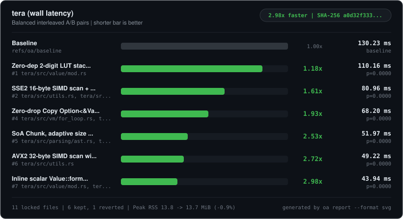

# Showcase: Keats/tera (2.98x faster rendering and escaping in Rust)

- Target: [Keats/tera](https://github.com/Keats/tera) (`v2.4.0`, commit `4ad3cd3f07`, 3.8k+ stars, template engine powering Zola)
- Profiler backend: `linux:perf` (rootless `:u` hardware counters + ELF `file:line` source snippets)
- Build profile: default features (`cargo build --release -p tera`, zero new crate dependencies)
- Host: `linux x86_64`, AMD Ryzen 7 9800X3D
- Verification: 99/99 upstream unit, snapshot, and integration tests pass (plus 83/83 with `--features fast`), 0 compiler warnings, 11 locked files intact, byte-identical output SHA-256 across 194,576,560 rendered bytes (`a0d32f3339f0a0b7`), 9 files changed in `tera/src/`
- Apply-ready patch: [`tera.patch`](tera.patch)

## Verified results (`oa verify --pairs 20`)

Workload: deterministic driver combining the four upstream benchmarks from `tera/benches/templates.rs` and `tera/benches/escape.rs`: `big-table` (100x100 HTML table x 240 renders), `realistic` (template inheritance + components x 6,000 renders), `teams` (struct list + `loop.index0` x 25,000 renders), and `escape_html` (`NO_HTML_VERY_LONG` + `HTML_VERY_LONG` x 35,000 iterations).

| Metric | Baseline (`4ad3cd3`) | After `oa` | Delta |
| --- | ---: | ---: | ---: |
| Interleaved median wall time (`n = 20` pairs) | 130.53 ms | 43.94 ms | **2.98x** (`95% CI [2.96x, 2.99x]`, `p = 0.0000`) |
| p95 / MAD | 136.03 ms / 0.34 ms | 44.55 ms / 0.31 ms | -67.2% p95 |
| `big-table` (100x100 table x 240) | 61.98 ms | 11.76 ms | **5.27x** |
| `escape_html` (long text + HTML x 35,000) | 42.66 ms | 12.04 ms | **3.54x** |
| `teams` (struct list x 25,000) | 12.69 ms | 9.12 ms | **1.39x** |
| `realistic` (inheritance + components x 6,000) | 11.65 ms | 8.74 ms | **1.33x** |
| Peak RSS | 14,156 KiB | 14,032 KiB | -0.9% |
| User instructions (`perf stat`) | 3,733,774,424 | 1,030,161,347 | **-72.4%** (-2.70B instructions) |
| User cycles (`perf stat`) | 679,927,052 | 228,036,392 | **-66.5%** (2.98x fewer cycles) |
| User branches (`perf stat`) | 785,681,594 | 220,605,690 | **-71.9%** |
| Branch misses (`perf stat`) | 457,107 | 186,921 | **-59.1%** |
| Upstream `cargo test` | 99/99 pass | 99/99 pass | 0 regressions |

## What `linux:perf` source-line profiling found

`Keats/tera` enables `[profile.release] debug = true`, so `oa profile` resolved ELF samples directly to Rust source lines and snippets:

1. `tera/src/utils.rs:122` (`tera::utils::escape_html`, 22.2% self): scanned one byte at a time with a 5-way match and invoked `&mut dyn Write` twice per HTML character.
2. `tera/src/vm/for_loop.rs:265` (`ForLoop::advance`, 14.2% self) plus `core::ptr::drop_glue::<ValueInner>` (11.7% self) and `State::get_value` (4.4% self): cloned and dropped `Value` on every loop iteration and `WritePath` instruction.
3. `<usize as core::fmt::Display>::fmt` and `Formatter::pad_integral` (5.9% self): default `Value::format` formatted every integer through `std::fmt` instead of direct decimal digits.
4. `tera/src/vm/interpreter.rs:217` (5.8% self) plus glibc `memmove` (7.5% self): the VM iterated 56-byte `(Instruction, Vec<Span>)` tuples, grew `Vec<u8>` from a small fixed `size_hint()`, allocated a SipHash `HashMap` per `ForLoop`, and dispatched per-cell `WriteText`/`WritePath` calls into `Vec::write_all`.

## Experiment ledger

| # | Status | Hypothesis | Files | Paired gain | 95% CI | p-value |
| ---: | --- | --- | --- | ---: | --- | ---: |
| 1 | KEPT | Zero-dep 2-digit lookup-table integer formatter in `Value::format` | `value/mod.rs` | 1.18x | [1.17x, 1.19x] | 0.0000 |
| 2 | KEPT | SSE2 16-byte SIMD scan (`(b \| 1) == '\'' \| (b \| 2) == '>' \| b == '"'`) + 256 B stack batching in `escape_html` + monomorphized default escape path | `utils.rs`, `interpreter.rs` | 1.36x | [1.35x, 1.36x] | 0.0000 |
| 3 | REVERTED | Zero-clone `ForLoop` using `ValueRef::Borrowed \| Owned` enum | `for_loop.rs`, `state.rs`, `interpreter.rs` | 0.92x | [0.91x, 0.92x] | 0.0000 |
| 4 | KEPT | Pure `Copy` 8-byte `Option<&Value>` borrowed lookup + zero-clone `Array` `ForLoop` | `for_loop.rs`, `state.rs`, `interpreter.rs` | 1.20x | [1.18x, 1.20x] | 0.0000 |
| 5 | KEPT | SoA `Chunk` (`Vec<Instruction>` + `Vec<Vec<Span>>`), adaptive output `size_hint`, `Vec` loop locals, lazy component context, and `Array` pure-output loop specialization | `ast.rs`, `compiler.rs`, `instructions.rs`, `template.rs`, `for_loop.rs`, `interpreter.rs`, `state.rs` | 1.32x | [1.30x, 1.33x] | 0.0000 |
| 6 | KEPT | Runtime-detected AVX2 32-byte SIMD scan (SSE2 fallback) and zero double-copy for long spans in `escape_html` | `utils.rs` | 1.07x | [1.05x, 1.09x] | 0.0000 |
| 7 | KEPT | Cold-outlined `Value::format_cold`, pre-decoded `FastLoopOp` array, and 4 KiB stack-buffered loop batching | `value/mod.rs`, `interpreter.rs` | 1.18x | [1.12x, 1.26x] | 0.0000 |

Experiment #3 is a good illustration of why interleaved measurement matters in Rust. Returning `enum ValueRef<'a> { Borrowed(&'a Value), Owned(Value) }` looked zero-copy on paper, but because the `Owned` variant carried `Value`'s `Drop` glue, the compiler emitted `drop_in_place` on every `WritePath` and regressed `big-table` by 8% (`0.92x`). `oa` rejected and reverted it immediately; replacing it in Experiment #4 with a plain `Copy` `Option<&Value>` (8 bytes, no `Drop`) delivered a verified `1.20x` speedup.

Direct 20-pair `oa verify` of final HEAD against `refs/oa/baseline`: `VERIFIED: 2.98x wall (95% CI [2.96x, 2.99x], p=0.0000), -0.5% peak RSS, SHA-256 exact, 11 locked file(s) intact`.

## Auto-generated chart (`oa report --format svg`)

<picture>
  <source media="(prefers-color-scheme: dark)" srcset="../assets/oa-report-example-dark.svg">
  <source media="(prefers-color-scheme: light)" srcset="../assets/oa-report-example-light.svg">
  
</picture>

## Reproduce

```bash
git clone https://github.com/Keats/tera.git
cd tera
git checkout 4ad3cd3f078e73f091dedd0272539e6497a89059
git apply /path/to/oa/docs/showcases/tera.patch
cargo test -p tera --lib
cargo test -p tera --tests
cargo test -p tera --features fast --lib
```
